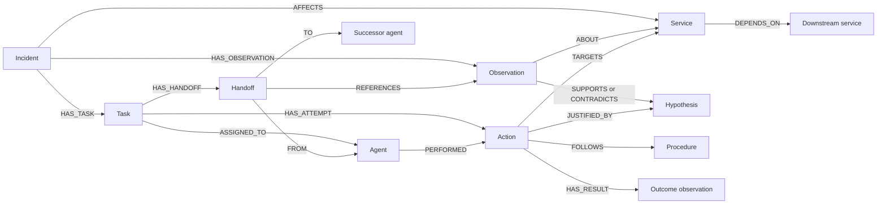

# Graph model sketch

The labels and relationships below describe Relay's domain model.

## Candidate entities

| Entity | Meaning |
| --- | --- |
| Incident | A bounded investigation into a service failure |
| Service | A sandbox component and its dependencies |
| Observation | Timestamped telemetry, tool output, or synthetic source evidence |
| Hypothesis | An inferred explanation, with supporting and contradicting evidence |
| Action | A particular attempted operation and its outcome |
| Agent | An acting role/session whose work can be handed over |
| Procedure | A reusable recovery method with applicability conditions |
| Task | A unit of work with ownership and progress |
| Handoff | A recorded transfer of responsibility and referenced context |

Relay maps each tenant to a deterministic FalkorDB graph namespace and applies incident scope to every connected-context query. Integration tests exercise cross-tenant and cross-incident boundaries.

## Relationship sketch

Each procedure should describe conditions under which it is applicable. An unsuccessful action should not automatically invalidate the procedure in every context. A later hypothesis may supersede an earlier one while retaining both evidence chains.

## Questions the graph should answer

- Which dependencies connect the failing service to a recent suspicious observation?
- Which actions already failed for this incident, and what evidence records their outcomes?
- What was believed before the handoff, and what evidence changed that belief?
- Which task is unresolved, who owns it, and what context should the successor retrieve?
- Which recovery procedure is supported under the current conditions?
- What evidence justified an action, and did subsequent telemetry confirm recovery?

These retrieval questions motivate the graph. Executable Cypher, indexes, API contracts, and precise property definitions belong to later implementation work.

## Memory and coordination boundaries

Keep raw observations distinct from extracted claims and agent conclusions. Preserve source references and distinguish observation time from ingestion time where delayed evidence matters.

The graph must connect earlier outcomes to current decisions. A summary string with no retrievable evidence would weaken the proposed memory demonstration.

Investigate explicit ownership and action identifiers for retry safety. Adding an ASSIGNED_TO edge alone does not establish atomic claiming or exactly-once execution. Validate backend behavior before selecting the coordination mechanism.

If using Graphiti, determine how domain concepts map to its entities, facts, and episodes before extending the graph. Keep framework-managed structures and application-owned task state clearly defined. See [framework research](../research/framework-comparison.md).
