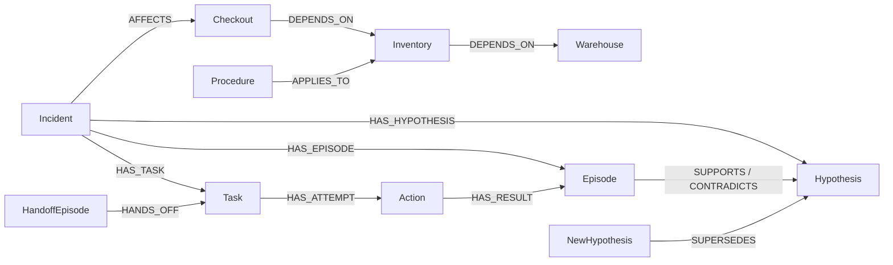

# Relay implementation

Build started October 15, 2026. Primary entry: Track 02. This document describes implemented behavior; the October 5 research documents preserve earlier proposals.

## Components

- `src/relay/memory.py`: tenant-scoped operational memory on FalkorDB. No in-memory or SQLite fallback.
- `src/relay/queries.py`: all core write guards, temporal updates, and multi-hop retrieval queries for review.
- `src/relay/runner.py`: controlled incident workflow and bounded successor decision.
- `src/relay/models.py`: local Ollama and explicitly configured Gemini adapters, with strict decision/citation validation.
- `src/relay/recall.py`: incident-scoped retrieval, context budgeting, safety pins, and persisted manifests.
- `src/relay/_vendor/cognee/`: attributed Cognee-derived rank fusion and graph-triplet formatting.
- `src/relay/graphiti_bridge.py`: older optional semantic extraction experiment; it is outside the main demo path.
- `src/relay/api.py`: local developer HTTP interface for incident context, claiming, and handoffs.
- `sandbox/server.py`: synthetic checkout → inventory → warehouse HTTP chain. Inventory runs in a separate subprocess that can actually be restarted.
- `frontend/`: React and TypeScript evidence console for the staged incident, guard test, successor decision, graph path, beliefs, and receipts.

## Graph model

Each tenant uses a separate graph named from a SHA-256 digest of its validated identifier. Operational and Graphiti graphs have different namespaces. Graphiti receives the explicit graph name as both driver database and group ID. All Cypher values are parameters.

Operational relationships:



Episodes hold observations, decisions, handoff summaries, claims, and tool results. Hypotheses retain their validity windows after correction. Procedure preconditions and service dependencies must be retrieved from the graph before the corrective operation is allowed. Model decisions store episode citations and provider usage metadata.

The task also stores an explicit workflow stage: `created`, `first_shift_running`, `handoff_ready`, `successor_running`, `action_running`, `verifying`, `uncertain`, or `resolved`. The task status remains the ownership/action state (`open`, `claimed`, `running`, or `done`).

## Coordination semantics

Claims are conditional writes in a single Cypher query. Only an open task or expired unstarted claim can be claimed. A token fences later memory writes and handoffs. Eight independent Python worker processes contend in the integration test.

```text
open → claimed → running → claimed → done
          ↓                   ↓
         open (handoff)       open (handoff)
```

`running` means an external operation might have executed. It never expires into an automatically retriable task. Reconciliation reads the original durable sandbox receipt by operation ID and never sends the action again. A missing or incomplete receipt remains `uncertain` and requires operator inspection. Do not promise exactly-once execution across FalkorDB and HTTP.

The sandbox durably reserves an operation ID before executing a tool. Completed requests return the same receipt on retry. An unfinished reservation returns a conflict instead of re-executing. Graph writes also reject another attempt of a tool already recorded as failed for that incident. The latter is deliberately conservative and may need context-sensitive refinement for future scenarios.

## What is AI-driven

The first shift is a controlled fixture: an initial hypothesis, failed restart, and handoff. Observation collection and hypothesis correction in the successor workflow are also explicit application logic.

With `--provider ollama` or `--provider gemini`, the successor's remediation choice and explanation come from one model call using graph context. The result must name an allowlisted tool and cite existing episode IDs. Application guards check failed attempts and procedure applicability; HTTP health verification determines resolution. The workflow is bounded, not an unrestricted autonomous investigator.

`--provider policy` is a deterministic test runner. It is labeled as such and makes no inference requests. No silent model fallback occurs.

## Cognee-derived retrieval boundary

The main successor path uses a narrow Apache-2.0 adaptation of Cognee's reciprocal-rank fusion and graph-triplet formatter. Relay supplies the lexical and graph-evidence lanes, incident scope, temporal rules, mandatory failed-action/configuration pins, 18 KB context budget, context hash, and persisted `CITES` edges. It uses FalkorDB directly and needs no embeddings or separate memory service. See [the component note](cognee-memory.md) and the vendor `PROVENANCE.json` for exact upstream files and hashes.

## Graphiti boundary

The optional bridge exports episodes into a separate semantic graph. Native Gemini inference, embedding, and reranking clients are all explicit; none defaults to another provider. Exports are serial, skip completed episode UUIDs, and must not run concurrently for the same tenant in this prototype.

The core works directly on FalkorDB. A Graphiti driver/index probe does not establish extraction quality or end-to-end model compatibility. Full Gemini ingestion/search remains unverified. The local Mistral model is used for bounded remediation decisions, not Graphiti embeddings.

## Limits and next work

- Local developer API only: tenant identifiers select graphs but are not authentication credentials. Bind to loopback; do not expose it as a public multi-user service.
- Sandbox cases have isolated configuration, but restarting inventory restarts the shared sandbox subprocess. Run demonstrations serially.
- One synthetic recovery scenario and one small decision-only history ablation; no general diagnosis benchmark or learning-effectiveness claim.
- Hypotheses use explicit application updates, not automatic conflict resolution by Graphiti.
- Local React interface and three-pair Mistral ablation are implemented; public deployment and submission video remain.
- Current ablation weakness: history changed the decision safely, but the model cited the failed receipt without citing the current probe.

## References checked during the build

- [Graphiti FalkorDB quickstart](https://github.com/getzep/graphiti/blob/main/examples/quickstart/quickstart_falkordb.py)
- [Graphiti FalkorDB driver](https://github.com/getzep/graphiti/blob/main/graphiti_core/driver/falkordb_driver.py)
- [Ollama chat API](https://docs.ollama.com/api/chat)
- [Gemini structured output](https://ai.google.dev/gemini-api/docs/structured-output)

Installed package source was also inspected for the actual constructor and method signatures. See `uv.lock` for resolved versions.
